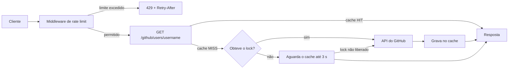

# API Gateway com Rate Limiting e Cache (FastAPI + Redis)

Serviço no estilo API Gateway, construído com **FastAPI** e **Redis**, que fica na frente da API REST do GitHub e implementa padrões de infraestrutura comuns em back-end: **rate limiting** com dois algoritmos, **acesso por tiers** via API key, **cache-aside com proteção contra cache stampede** e **observabilidade por requisição**.

> Projeto de portfólio com foco na corretude dos algoritmos de infraestrutura, não em regra de negócio.
>
> Projeto complementar: [AsyncTask Hub, API de Processamento Assíncrono de Imagens](https://github.com/PedroHTLemos/async-task-hub) (filas com Celery, idempotência e Dead Letter Queue).

---

## Sobre o projeto

O serviço atua como intermediário entre o cliente e uma API externa (a API REST do GitHub), com dois objetivos:

1. **Proteger a origem e o próprio serviço** contra excesso de requisições, aplicando limites diferentes conforme o tier da API key.
2. **Reduzir a latência** das consultas repetidas com cache em Redis, evitando que várias requisições simultâneas busquem o mesmo dado na origem ao mesmo tempo.

O Redis é o único armazenamento da aplicação: guarda os contadores de rate limit, as respostas em cache e os locks distribuídos. Não há banco relacional.

### Fluxo de uma requisição



---

## Funcionalidades implementadas

**Rate limiting**
- Dois algoritmos, escolhidos por variável de ambiente:
  - **Fixed Window**, com `INCR` + `EXPIRE`.
  - **Sliding Window Log**, com Sorted Set (`ZSET`).
- Tiers de acesso pelo header `X-API-Key` (aplicados no algoritmo Sliding Window Log; o Fixed Window usa um limite único por IP, configurável por variável de ambiente):

  | Tier | Limite |
  |---|---|
  | `anonymous` (sem chave ou chave inválida) | 5 req/min, separado por IP |
  | `free` | 10 req/min |
  | `premium` | 100 req/min |

- Respostas `429 Too Many Requests` com header `Retry-After`.
- Headers informativos nas respostas permitidas: `X-RateLimit-Limit` e `X-RateLimit-Remaining` (e `X-RateLimit-Tier` no Sliding Window Log).
- Os endpoints `/health`, `/docs` e `/openapi.json` não passam pelo rate limit.

**Cache**
- Cache-aside em Redis para `GET /github/users/{username}`, com TTL configurável (padrão: 300 s).
- Lock distribuído (`SET NX EX`) para evitar cache stampede: só a requisição que obtém o lock busca na origem; as demais fazem polling do cache por até 3 s.
- Fallback para a origem caso o lock não seja liberado dentro do tempo de espera.
- Liberação do lock somente por quem o adquiriu (verificação por token).
- Invalidação manual: `DELETE /github/users/{username}/cache`.

**Observabilidade**
- Middleware ASGI puro que adiciona o header `X-Cache: HIT | MISS | N/A` a cada resposta.

**Operação**
- Health check em `GET /health`.

### Endpoints

| Método | Rota | Descrição |
|---|---|---|
| `GET` | `/github/users/{username}` | Busca um usuário do GitHub, com cache e proteção anti-stampede |
| `DELETE` | `/github/users/{username}/cache` | Remove a entrada desse usuário do cache |
| `GET` | `/health` | Health check (fora do rate limit) |
| `GET` | `/docs` | Documentação interativa gerada pelo FastAPI (fora do rate limit) |

---

## Tecnologias utilizadas

| Categoria | Tecnologia |
|---|---|
| Linguagem | Python 3.12 |
| Framework web | FastAPI |
| Servidor ASGI | Uvicorn |
| Armazenamento | Redis 7 (cliente `redis.asyncio`) |
| Cliente HTTP | httpx |
| Containers | Docker, Docker Compose |
| Teste de carga | k6 |
| Integração | API REST do GitHub (origem) |

---

## Como executar

### Pré-requisitos

- Docker e Docker Compose
- k6 (somente para os testes de carga)

### Subindo a aplicação

```bash
git clone https://github.com/PedroHTLemos/api-gateway-rate-limit-cache.git
cd api-gateway-rate-limit-cache
docker compose up --build
```

A API fica disponível em `http://localhost:8000` e a documentação interativa em `http://localhost:8000/docs`.

### Variáveis de ambiente

| Variável | Descrição | Padrão |
|---|---|---|
| `RATE_LIMIT_ALGORITHM` | Algoritmo de rate limit (`fixed_window` ou `sliding_window_log`) | `fixed_window` (o `docker-compose.yml` usa `sliding_window_log`) |
| `RATE_LIMIT_MAX_REQUESTS` | Limite de requisições por janela (Fixed Window) | `10` |
| `RATE_LIMIT_WINDOW_SECONDS` | Tamanho da janela em segundos (Fixed Window) | `60` |
| `CACHE_TTL_SECONDS` | TTL do cache em segundos | `300` |
| `REDIS_URL` | URL de conexão com o Redis | `redis://localhost:6379/0` |

### Exemplos de uso

```bash
# Requisição anônima (tier anonymous, 5 req/min por IP)
curl -i http://localhost:8000/github/users/octocat

# Requisição com API key de demonstração (tier free, 10 req/min)
curl -i -H "X-API-Key: free-key-123" http://localhost:8000/github/users/octocat

# Requisição com API key de demonstração (tier premium, 100 req/min)
curl -i -H "X-API-Key: premium-key-456" http://localhost:8000/github/users/octocat

# Invalidar o cache de um usuário
curl -i -X DELETE http://localhost:8000/github/users/octocat/cache

# Health check
curl http://localhost:8000/health
```

Na primeira chamada o header `X-Cache` vem como `MISS`; nas seguintes, dentro do TTL, como `HIT`.

---

## Organização do código

```
app/
├── core/
│   ├── config.py               # Configuração via variáveis de ambiente
│   ├── api_keys.py             # API keys e definição dos tiers
│   ├── github_client.py        # Cliente HTTP (httpx) para a API do GitHub
│   └── redis_client.py         # Cliente Redis assíncrono
├── middlewares/
│   ├── rate_limiter.py                 # Fixed Window (INCR/EXPIRE)
│   ├── sliding_window_rate_limiter.py  # Sliding Window Log (ZSET)
│   └── observability.py                # Middleware ASGI do header X-Cache
├── routes/
│   └── github.py               # Rota com cache-aside, lock e invalidação
└── main.py                     # Criação da aplicação e registro dos middlewares
load-tests/
└── load-test.js                # Cenários de carga com k6
Dockerfile
docker-compose.yml
requirements.txt
```

---

## Decisões técnicas e conhecimentos aplicados

**Dois algoritmos de rate limiting, com troca por configuração.**
O Fixed Window é simples e barato (um contador por janela), mas permite rajadas na virada da janela: um cliente pode fazer o dobro do limite em poucos segundos. O Sliding Window Log guarda o timestamp de cada requisição em um `ZSET` e conta apenas as que estão dentro dos últimos 60 s, o que elimina esse efeito em troca de mais memória por cliente. Manter os dois permite comparar o comportamento sem alterar o código.

**Tiers por API key, com fallback para o tier mais restritivo.**
Sem chave válida, a requisição cai no tier `anonymous`, identificado pelo IP. Assim, um cliente sem credencial nunca recebe um limite maior do que deveria.

**Contrato HTTP explícito para o cliente.**
O `429` vem com `Retry-After`, e os headers `X-RateLimit-*` informam limite, saldo restante e tier, permitindo que o cliente ajuste o ritmo das chamadas.

**Cache-aside com proteção contra stampede.**
Quando uma entrada expira, várias requisições simultâneas poderiam ir à origem ao mesmo tempo. Com o lock `SET NX EX`, apenas uma busca o dado; as outras aguardam o cache ser preenchido. O `EX` garante que o lock expire sozinho se o processo que o detém falhar.

**Liberação segura do lock.**
Cada lock é gravado com um token único e só é removido por quem o criou. Isso evita que uma requisição lenta, cujo lock já expirou, apague o lock que outra requisição adquiriu depois. Hoje a verificação e a remoção são duas chamadas separadas (`GET` + `DELETE`); torná-las atômicas está nas melhorias futuras.

**Degradação controlada.**
Se o lock não for liberado em até 3 s, a requisição vai direto à origem em vez de falhar. A prioridade é responder, mesmo que sem o benefício do cache.

**Middleware ASGI puro para observabilidade.**
O header `X-Cache` é adicionado por um middleware ASGI escrito diretamente sobre a interface `scope/receive/send`, sem a camada de abstração do `BaseHTTPMiddleware`.

**Investigação de uma anomalia no benchmark.**
Durante o teste de carga, a latência de cache HIT apareceu com distribuição bimodal: a maioria em poucos milissegundos, mas cerca de 10% acima de 300 ms. A suspeita inicial foi um problema no middleware. A causa real era o próprio cenário: ele purga o cache e dispara 20 usuários virtuais contra a mesma chave, provocando o stampede que o lock foi feito para tratar. As requisições lentas eram as que esperaram o lock, corretamente classificadas como HIT. Separar as métricas em `cache_hit_latency_ms` e `cache_hit_after_lock_wait_latency_ms` deixou esse comportamento explícito.

**Código assíncrono de ponta a ponta.**
FastAPI, `redis.asyncio` e `httpx` permitem que a espera por rede (Redis e GitHub) não bloqueie o processamento de outras requisições.

**Ambiente reproduzível.**
Aplicação e Redis sobem juntos com Docker Compose, sem instalação local de Python ou Redis.

---

## Testes automatizados

A suíte em `tests/` tem **26 casos**: 25 testes de comportamento e 1 teste marcado como `xfail` (limitação conhecida, veja abaixo). Nenhum teste precisa de Redis real nem de acesso à rede: o Redis é substituído por `fakeredis`, a API do GitHub por uma origem falsa que conta chamadas, e a passagem do tempo é simulada no módulo dos limitadores.

| Arquivo | O que cobre |
|---|---|
| `test_cache.py` | MISS/HIT e cabeçalho `X-Cache` (incluindo `N/A` em `/` e `/health`), usuário inexistente dá 404 e não é cacheado, `DELETE` de cache (200, e 404 quando não existe), liberação do lock |
| `test_cache_stampede.py` | 10 requisições concorrentes para o mesmo usuário geram uma única chamada à origem; as demais respondem do cache com `waited_for_lock=True` |
| `test_fixed_window.py` | Limite com `X-RateLimit-*` corretos, 429 com `Retry-After`, `/health` isento, contadores separados por IP, contador recomeça quando a janela vira |
| `test_sliding_window.py` | Limites por tier (anonymous 5, free 10, premium 100), chave inválida cai em anonymous, anônimos de IPs diferentes não compartilham limite, 429 traz `tier` e `Retry-After`, `X-RateLimit-Tier`, requisições antigas saem da janela |
| `test_known_limitations.py` | `xfail`: race do Sliding Window sob concorrência (veja abaixo) |

Como rodar:

```bash
pip install -r requirements-dev.txt
pytest
```

O workflow `.github/workflows/tests.yml` roda a mesma suíte no Python 3.12 a cada push e pull request.

**Limitação conhecida (xfail).** O Sliding Window executa `ZREMRANGEBYSCORE`, `ZCARD` e `ZADD` em comandos separados. Requisições concorrentes podem, em tese, ler o mesmo `ZCARD` antes de qualquer `ZADD` e ultrapassar o limite. O teste `test_known_limitations.py` dispara 20 requisições simultâneas com limite 5 e espera que no máximo 5 sejam aceitas. Ele está marcado com `xfail(strict=True)`: hoje falha como esperado, com as 20 requisições aceitas. Quando a correção for feita, o teste passará e a suíte quebrará de propósito, lembrando de remover o marcador.

A latência de rede é simulada no teste: cada comando do limitador (`ZREMRANGEBYSCORE`, `ZCARD`, `ZADD`, `ZRANGE`, `EXPIRE`) espera 5 ms antes de executar. Isso é necessário porque o `fakeredis` executa os comandos sem ceder o event loop, então as requisições concorrentes não se intercalam e a race não aparece. Com um Redis real, cada comando é uma ida e volta pela rede, e é aí que a race acontece. A simulação mostra o mecanismo, mas não substitui um teste contra Redis real. A correção prevista é um script Lua que execute as três operações de forma atômica.

## Testes de carga

O projeto possui um script k6 (`load-tests/load-test.js`) com três cenários isolados:

| Cenário | O que verifica |
|---|---|
| MISS sequencial | Latência das requisições que vão até a API do GitHub |
| HIT com 20 VUs concorrentes | Latência das respostas servidas pelo cache sob concorrência |
| MISS com rate limit | Comportamento do limitador e quantidade de respostas `429` |

Métricas customizadas: HIT, HIT após espera do lock, MISS e quantidade de `429`.
Threshold configurado: **p95 do HIT < 50 ms**.

Para executar (com a aplicação rodando):

```bash
k6 run load-tests/load-test.js
```

### Resultados

| Métrica | Resultado (p95) |
|---|---|
| Cache MISS (ida à API do GitHub) | ~270 ms |
| Cache HIT sem contenção | ~14 ms |
| Cache HIT após espera do lock | ~323 ms |

Mesmo no pior caso (requisições que esperaram o lock), a latência ficou na mesma ordem de um cache MISS, enquanto apenas uma requisição foi à origem.

> Resultados obtidos em ambiente local; variam conforme a máquina e a latência até a API do GitHub.

O projeto **não possui testes unitários nem de integração** até o momento.

---

## Melhorias futuras

- Testes de integração contra um Redis real (via Docker), para reproduzir a race do Sliding Window e validar o lock com servidor de verdade.
- Operações atômicas com script Lua no Redis (sliding window e liberação do lock com verificação de token).
- Lint no pipeline de CI (os testes já rodam no GitHub Actions).
- Arquivo `.env.example` documentando as variáveis de ambiente, com as API keys fora do código.
- Aplicar os tiers também no algoritmo Fixed Window.
- Métricas e logs estruturados por requisição (latência, tier, resultado do cache).
