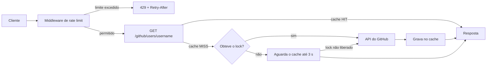
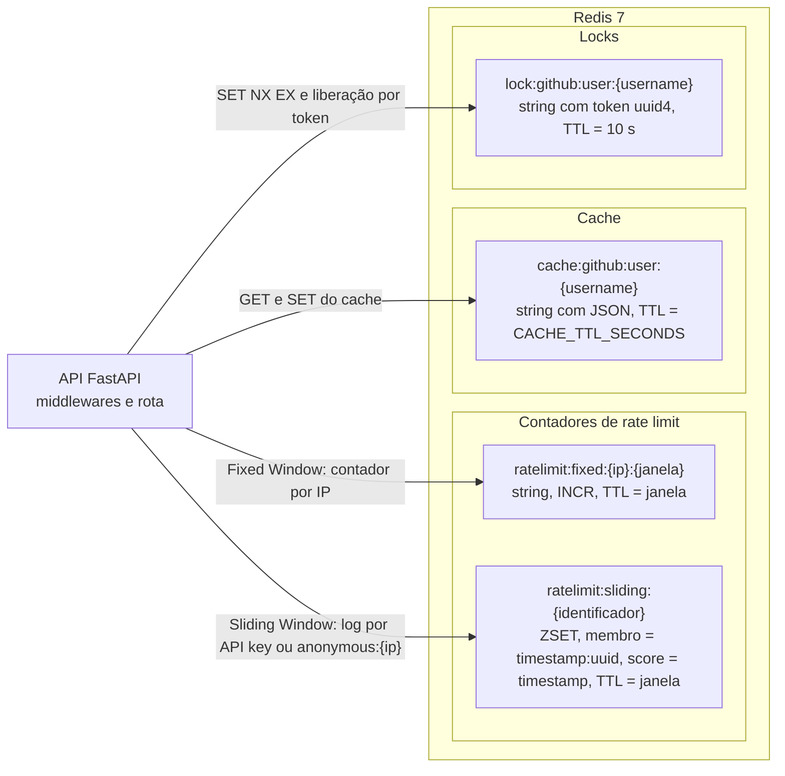
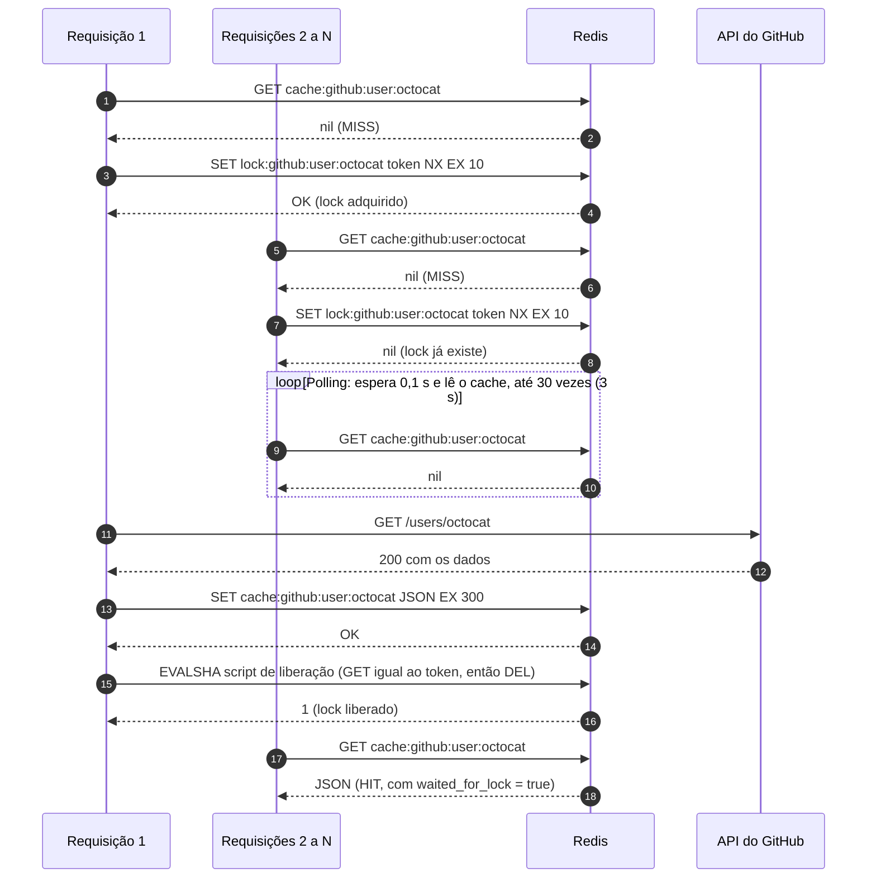

# API Gateway com Rate Limiting e Cache (FastAPI + Redis)

[](https://github.com/PedroHTLemos/api-gateway-rate-limit-cache/actions/workflows/tests.yml)

Serviço no estilo API Gateway, em FastAPI e Redis, que fica na frente da API REST do GitHub. Implementa rate limiting com dois algoritmos, acesso por tiers via API key e cache-aside com proteção contra cache stampede.

> Projeto de portfólio com foco na corretude dos algoritmos de infraestrutura, não em regra de negócio. Não é um sistema em produção.
>
> Projetos complementares:
> - [AsyncTask Hub](https://github.com/PedroHTLemos/async-task-hub): API de processamento assíncrono de imagens, com filas Celery, idempotência e Dead Letter Queue.
> - [API de Pedidos e Estoque](https://github.com/PedroHTLemos/api-pedidos-estoque-spring): backend em Spring Boot com baixa de estoque consistente sob concorrência.

---

## Destaques

- **20 requisições simultâneas com limite 5 resultam em exatamente 5 aceitas.** Teste de concorrência do Sliding Window (`test_concorrencia_nao_ultrapassa_limite`). Com o código anterior ao commit `d0133be`, o mesmo teste aceita as 20 requisições ([decisão 2](#2-atomicidade-com-scripts-lua)).
- **10 requisições concorrentes para o mesmo usuário geram uma única chamada à origem.** Lock com `SET NX EX` e polling do cache (`test_requisicoes_concorrentes_geram_uma_unica_chamada_a_origem`) ([decisão 5](#5-cache-aside-com-proteção-contra-stampede)).
- **Operações de Redis atômicas com scripts Lua.** O Sliding Window fazia `ZCARD` e `ZADD` em comandos separados, e requisições concorrentes passavam do limite ([decisão 2](#2-atomicidade-com-scripts-lua)).
- **37 testes, executados pelo workflow de CI a cada push e pull request** ([Testes](#testes)).

---

## Stack

| Categoria | Tecnologia | Versão |
|---|---|---|
| Linguagem | Python | 3.12 (imagem `python:3.12-slim`) |
| Framework web | FastAPI | 0.165.0 |
| Servidor ASGI | Uvicorn, com extras `standard` | 0.54.0 |
| Armazenamento | Redis (imagem `redis:7-alpine` no Compose) | 7 |
| Cliente Redis | redis-py, módulo `redis.asyncio` | 8.2.0 |
| Cliente HTTP | httpx | 0.29.0 |
| Configuração | python-dotenv (declarada em `requirements.txt`, não importada pelo código) | 1.2.4 |
| Testes | pytest | 9.2.0 |
| Testes assíncronos | pytest-asyncio | 1.5.0 |
| Redis em memória nos testes | fakeredis, com extra `lua` (lupa 2.8) | 2.41.0 |
| Teste de carga | k6 (não versionado no repositório) | v2.0.0 instalado localmente |
| Containers | Docker, Docker Compose (imagens `python:3.12-slim` e `redis:7-alpine`) | sem versão fixada |
| Integração | API REST do GitHub (origem) | header `Accept: application/vnd.github+json` |
| CI | GitHub Actions | `actions/checkout@v4`, `actions/setup-python@v5` |

Os arquivos `requirements.txt` e `requirements-dev.txt` não fixam versões. As versões acima são as instaladas no `.venv` usado para rodar a suíte.

---

## Sumário

- [Destaques](#destaques)
- [Stack](#stack)
- [Arquitetura](#arquitetura)
- [Funcionalidades e Endpoints](#funcionalidades-e-endpoints)
- [Decisões técnicas](#decisões-técnicas)
- [Limitações conhecidas](#limitações-conhecidas)
- [Como rodar](#como-rodar)
- [Configuração](#configuração)
- [Exemplos de uso](#exemplos-de-uso)
- [Testes](#testes)
- [Testes de carga](#testes-de-carga)
- [CI](#ci)
- [Próximos passos](#próximos-passos)

---

## Arquitetura

### Objetivos

O serviço atua como intermediário entre o cliente e a API REST do GitHub, com dois objetivos:

1. **Proteger a origem e o próprio serviço** contra excesso de requisições, aplicando limites diferentes conforme o tier da API key.
2. **Reduzir a latência** das consultas repetidas com cache em Redis, evitando que várias requisições simultâneas busquem o mesmo dado na origem ao mesmo tempo.

O Redis é o único armazenamento da aplicação: guarda os contadores de rate limit, as respostas em cache e os locks distribuídos. Não há banco relacional.

### Fluxo de uma requisição



### Papéis do Redis

O diagrama mostra as chaves que a aplicação grava no Redis. Os formatos vêm de `app/middlewares/rate_limiter.py`, `app/middlewares/sliding_window_rate_limiter.py` e `app/routes/github.py`.



- `{ip}` é o IP do cliente e `{janela}` é `int(time / RATE_LIMIT_WINDOW_SECONDS)`.
- `{identificador}` é a API key válida ou `anonymous:{ip}` quando não há chave válida.
- O cache e o lock usam o mesmo `{username}` da rota.

### Cache stampede

O diagrama mostra o caminho de uma entrada expirada, com uma requisição que busca na origem e as demais esperando o cache.



Se o lock não for liberado em 3 s, a requisição que esperou vai direto à origem (ver [decisão 7](#7-degradação-controlada-do-lock)).

### Organização do código

```
app/
├── core/
│   ├── config.py               # Configuração via variáveis de ambiente
│   ├── api_keys.py             # API keys e definição dos tiers
│   ├── github_client.py        # Cliente HTTP (httpx) para a API do GitHub
│   └── redis_client.py         # Cliente Redis assíncrono
├── middlewares/
│   ├── rate_limiter.py                 # Fixed Window (INCR/EXPIRE)
│   ├── sliding_window_rate_limiter.py  # Sliding Window Log (ZSET)
│   └── observability.py                # Middleware ASGI do header X-Cache
├── routes/
│   └── github.py               # Rota com cache-aside, lock e invalidação
└── main.py                     # Criação da aplicação e registro dos middlewares
tests/
├── conftest.py                 # Fixtures: fakeredis, origem falsa, relógio e bloqueio de rede
├── fakes.py                    # FakeGitHub e LatencyRedis
└── test_*.py                   # Testes por área (ver Testes)
load-tests/
└── load-test.js                # Cenários de carga com k6
.github/workflows/tests.yml     # CI: pytest em cada push e pull request
Dockerfile
docker-compose.yml
pytest.ini
requirements.txt
requirements-dev.txt
```

---

## Funcionalidades e Endpoints

**Rate limiting**
- Dois algoritmos, escolhidos por variável de ambiente:
  - **Fixed Window**, com `INCR` + `EXPIRE`.
  - **Sliding Window Log**, com Sorted Set (`ZSET`).
- Tiers de acesso pelo header `X-API-Key` (aplicados no algoritmo Sliding Window Log; o Fixed Window usa um limite único por IP, configurável por variável de ambiente):

  | Tier | Limite |
  |---|---|
  | `anonymous` (sem chave ou chave inválida) | 5 req/min, separado por IP |
  | `free` | 10 req/min |
  | `premium` | 100 req/min |

- Respostas `429 Too Many Requests` com header `Retry-After`.
- Headers informativos nas respostas permitidas: `X-RateLimit-Limit` e `X-RateLimit-Remaining` (e `X-RateLimit-Tier` no Sliding Window Log).
- Os endpoints `/health`, `/docs` e `/openapi.json` não passam pelo rate limit.

**Cache**
- Cache-aside em Redis para `GET /github/users/{username}`, com TTL configurável (padrão: 300 s).
- Lock distribuído (`SET NX EX`) para evitar cache stampede: só a requisição que obtém o lock busca na origem; as demais fazem polling do cache por até 3 s.
- Fallback para a origem caso o lock não seja liberado dentro do tempo de espera.
- Liberação do lock somente por quem o adquiriu (verificação por token, em script Lua atômico).
- Falhas da origem viram respostas claras: timeout -> `504`; erro HTTP (403, 429, 5xx) ou falha de conexão -> `502`.
- Invalidação manual: `DELETE /github/users/{username}/cache`.

**Observabilidade**
- Middleware ASGI puro que adiciona o header `X-Cache: HIT | MISS | N/A` a cada resposta.

**Operação**
- Health check em `GET /health`.

### Endpoints

| Método | Rota | Descrição |
|---|---|---|
| `GET` | `/github/users/{username}` | Busca um usuário do GitHub, com cache e proteção anti-stampede. Retorna `404` se não existir, `502` ou `504` se a origem falhar |
| `DELETE` | `/github/users/{username}/cache` | Remove a entrada desse usuário do cache |
| `GET` | `/health` | Health check (fora do rate limit) |
| `GET` | `/docs` | Documentação interativa gerada pelo FastAPI (fora do rate limit) |

---

## Decisões técnicas

Cada decisão segue o mesmo formato: problema, decisão, alternativa descartada (quando houve) e como foi verificada.

### 1. Dois algoritmos de rate limiting, com troca por configuração

- **Problema:** o Fixed Window é simples e barato (um contador por janela), mas permite rajadas na virada da janela: um cliente pode fazer o dobro do limite em poucos segundos.
- **Decisão:** o Sliding Window Log guarda o timestamp de cada requisição em um `ZSET` e conta apenas as que estão dentro dos últimos 60 s. Isso elimina o efeito de rajada em troca de mais memória por cliente. Manter os dois permite comparar o comportamento sem alterar o código. A escolha é feita por `RATE_LIMIT_ALGORITHM`.
- **Como foi verificado:** `test_contador_recomeca_quando_a_janela_vira` (Fixed Window) e `test_requisicoes_antigas_saem_da_janela_e_novas_sao_aceitas` (Sliding Window). A rajada na virada da janela do Fixed Window não tem teste próprio.

### 2. Atomicidade com scripts Lua

- **Problema:** operações de Redis em comandos separados criam uma janela entre a leitura e a escrita, e outra requisição pode se intercalar nela. No Sliding Window, `ZCARD` e `ZADD` separados deixavam requisições concorrentes passarem do limite. No Fixed Window, um `INCR` seguido de um `EXPIRE` separados deixariam, por um instante, uma chave de contador sem expiração.
- **Decisão:** cada limitador faz suas operações em um script Lua, executado de forma atômica pelo Redis.
  - *Fixed Window*: `INCR` e `EXPIRE` no mesmo script. O TTL nasce junto com o primeiro incremento, então nunca existe chave de contador sem expiração.
  - *Sliding Window Log*: remoção das entradas antigas, contagem e inserção rodam juntas. A nova requisição só entra no log se estiver abaixo do limite, e o script devolve a contagem e o timestamp mais antigo para montar o `Retry-After`.
- **Alternativa descartada:** `ZCARD` e `ZADD` em comandos separados, que era a versão anterior do Sliding Window (commit `5ba559b`).
- **Como foi verificado:** `test_concorrencia_nao_ultrapassa_limite` faz 20 requisições simultâneas contra o limite anônimo de 5 e confere 5 aceitas e 15 recusadas. Com o código anterior ao commit `d0133be`, rodando o mesmo teste, as 20 requisições são aceitas e o teste falha. A latência simulada que torna a race visível está na [decisão 10](#10-latência-simulada-no-teste-de-concorrência).

### 3. Tiers por API key, com fallback para o tier mais restritivo

- **Problema:** clientes com necessidades de volume diferentes não podem compartilhar um único limite.
- **Decisão:** sem chave válida, a requisição cai no tier `anonymous`, identificado pelo IP. Assim, um cliente sem credencial nunca recebe um limite maior do que deveria. Os tiers são aplicados só no Sliding Window Log.
- **Como foi verificado:** `test_limite_por_tier` (parametrizado para `anonymous`, `free` e `premium`), `test_chave_invalida_cai_em_anonymous` e `test_anonimos_de_ips_diferentes_nao_compartilham_limite`.

### 4. Contrato HTTP explícito para o cliente

- **Problema:** o cliente precisa saber quanto tempo esperar e quanto ainda pode consumir.
- **Decisão:** o `429` vem com `Retry-After`, e os headers `X-RateLimit-*` informam limite, saldo restante e tier. No Sliding Window, o `Retry-After` vem do timestamp mais antigo dentro da janela. No Fixed Window, vem do TTL da chave.
- **Como foi verificado:** `test_ate_o_limite_responde_200_com_headers_corretos`, `test_requisicao_acima_do_limite_recebe_429_com_retry_after`, `test_429_traz_tier_e_retry_after` e `test_x_ratelimit_tier_presente_nas_respostas_aceitas`.

### 5. Cache-aside com proteção contra stampede

- **Problema:** quando uma entrada expira, várias requisições simultâneas poderiam ir à origem ao mesmo tempo.
- **Decisão:** com o lock `SET NX EX`, apenas uma requisição busca o dado; as outras leem o cache a cada 0,1 s, por até 3 s. O `EX` garante que o lock expire sozinho se o processo que o detém falhar. Em falha da origem, nada é cacheado e o lock é liberado.
- **Como foi verificado:** `test_requisicoes_concorrentes_geram_uma_unica_chamada_a_origem`, `test_requisicoes_que_esperam_o_lock_recebem_x_cache_hit` e `test_lock_e_liberado_apos_a_rajada`.

### 6. Liberação segura do lock

- **Problema:** uma requisição lenta, cujo lock já expirou, poderia apagar o lock que outra requisição adquiriu depois.
- **Decisão:** cada lock é gravado com um token único (`uuid4`) e só é removido por quem o criou. A verificação e a remoção rodam em um único script Lua, então não há janela entre elas.
- **Alternativa descartada:** `GET` seguido de `DEL`. Entre os dois comandos, o lock podia expirar e ser adquirido por outra requisição.
- **Como foi verificado:** `test_release_lock_nao_apaga_lock_de_outro_token`, `test_release_lock_apaga_lock_do_proprio_token` e `test_lock_e_liberado_apos_a_requisicao`.

### 7. Degradação controlada do lock

- **Problema:** se a requisição que tem o lock demorar ou falhar, as demais não podem esperar indefinidamente.
- **Decisão:** a espera máxima é de 3 s (30 tentativas de 0,1 s). Depois disso, a requisição vai direto à origem, sem lock. A prioridade é responder, mesmo sem o benefício do cache.
- **Como foi verificado:** o lock é liberado em qualquer falha (`test_lock_e_liberado_mesmo_quando_usuario_nao_existe` e `test_falha_da_origem_mapeada_para_status_http`). Nenhum teste força a espera de 3 s, então o caminho de fallback não é coberto pela suíte (ver [Limitações](#limitações-conhecidas)).

### 8. Falhas da origem mapeadas para HTTP

- **Problema:** exceções do httpx chegariam ao cliente como `500`, sem indicar se a causa foi lentidão ou falha.
- **Decisão:** timeout da API do GitHub vira `504 Gateway Timeout`. Erro HTTP (403 por rate limit do GitHub, 429, 5xx) ou falha de conexão vira `502 Bad Gateway`. O `404` de usuário inexistente continua sendo `404`. Em qualquer falha, nada é cacheado e o lock é liberado.
- **Como foi verificado:** `test_falha_da_origem_mapeada_para_status_http` (seis casos parametrizados: timeouts de leitura e de conexão, 403, 429, 500 e erro de conexão), `test_requisicao_seguinte_funciona_apos_falha_da_origem` e `test_404_da_origem_continua_404`. O JSON inválido da origem não é mapeado (ver [Limitações](#limitações-conhecidas)).

### 9. Middleware ASGI puro para observabilidade

- **Problema:** o header `X-Cache` precisa aparecer em todas as respostas, sem estado compartilhado entre requisições concorrentes.
- **Decisão:** o header é adicionado por um middleware ASGI escrito diretamente sobre a interface `scope/receive/send`. Cada requisição tem seu próprio estado, guardado no `scope`.
- **Alternativa descartada:** `BaseHTTPMiddleware`. O comentário do módulo registra que essa classe tem histórico de vazar estado entre requisições concorrentes em algumas versões do Starlette.
- **Como foi verificado:** `test_primeira_chamada_e_miss_da_origem`, `test_segunda_chamada_e_hit_do_cache` e `test_x_cache_e_na_para_raiz_e_health`. `test_requisicoes_que_esperam_o_lock_recebem_x_cache_hit` confere o header em 10 requisições simultâneas.

### 10. Latência simulada no teste de concorrência

- **Problema:** o `fakeredis` executa os comandos sem ceder o event loop. Requisições concorrentes não se intercalam, e uma race não apareceria no teste.
- **Decisão:** `tests/fakes.py` envolve o Redis fake em `LatencyRedis`, que espera 5 ms antes de cada comando do limitador (`ZREMRANGEBYSCORE`, `ZCARD`, `ZADD`, `ZRANGE`, `EXPIRE`, `EVALSHA`, `EVAL` e `SCRIPT LOAD`). Isso simula a ida e volta de rede de um Redis real.
- **Alternativa descartada:** o teste sem latência, que não reproduz a race.
- **Como foi verificado:** `test_concorrencia_nao_ultrapassa_limite`. Isso não substitui um teste contra Redis real, que ainda está nas [Próximas etapas](#próximos-passos).

### 11. Investigação de uma anomalia no benchmark

- **Problema:** durante o teste de carga, a latência de cache HIT apareceu com distribuição bimodal: a maioria em poucos milissegundos, mas cerca de 10% acima de 300 ms.
- **Decisão:** a primeira hipótese foi um problema no middleware. A causa real era o próprio cenário: ele purga o cache e dispara 20 usuários virtuais contra a mesma chave, provocando o stampede que o lock trata. As requisições lentas eram as que esperaram o lock, corretamente classificadas como HIT. Separar as métricas em `cache_hit_latency_ms` e `cache_hit_after_lock_wait_latency_ms` deixou esse comportamento explícito.
- **Alternativa descartada:** o problema no middleware, descartado pela análise das requisições lentas.
- **Como foi verificado:** medição do benchmark anterior, com as duas métricas separadas em `load-tests/load-test.js`. Não há teste automatizado para isso, e a anomalia não foi reproduzida nesta revisão.

### 12. Código assíncrono de ponta a ponta

- **Problema:** a espera por rede (Redis e API do GitHub) não pode bloquear o processamento das demais requisições.
- **Decisão:** FastAPI, `redis.asyncio` e `httpx`. O polling do lock usa `asyncio.sleep`, então a espera não ocupa o event loop.
- **Como foi verificado:** `test_requisicoes_concorrentes_geram_uma_unica_chamada_a_origem` faz 10 requisições simultâneas com uma origem que demora 0,3 s. A suíte só passa porque essas requisições rodam em paralelo.

### 13. Ambiente reproduzível

- **Problema:** rodar a aplicação exige Python, Redis e as dependências nas versões esperadas.
- **Decisão:** o `docker-compose.yml` sobe a API e o Redis 7 juntos. O `Dockerfile` usa `python:3.12-slim`.
- **Como foi verificado:** leitura de `docker-compose.yml` e `Dockerfile`. A stack não foi executada nesta revisão.

---

## Limitações conhecidas

- **Tiers só no Sliding Window.** O Fixed Window ignora o header `X-API-Key` e aplica um limite único por IP.
- **API keys no código.** As chaves e os tiers ficam em `app/core/api_keys.py`, sem variável de ambiente nem `.env.example`. As duas chaves de demonstração estão no repositório.
- **Redis fora do ar derruba as rotas que passam pelos limitadores.** Não há fallback. Com o Redis indisponível, `GET /github/users/{username}` responde `500`, e `GET /health` continua `200`. Verificado com o Redis apontado para uma porta sem servidor.
- **JSON inválido da origem vira `500`.** `response.json()` levanta `JSONDecodeError`, que não é uma exceção do httpx e não passa pelo mapeamento de `502`/`504`. Verificado com uma origem que responde HTML com status 200.
- **Rate limit por IP sem tratamento de proxy.** O limitador usa `request.client.host`, o IP da conexão, e não lê `X-Forwarded-For`. Atrás de um proxy ou balanceador, todos os clientes compartilham o mesmo IP.
- **Lock com TTL igual ao timeout da origem.** O lock expira em 10 s, e a chamada à origem também tem timeout de 10 s. Se a busca demorar até o timeout, o lock pode expirar antes do fim, e outra requisição pode então buscar na origem. A liberação por token impede apagar o lock de outra requisição, mas não impede essa segunda busca.
- **Fallback após 3 s vai à origem sem lock.** Se a origem estiver lenta, cada requisição que esperou 3 s busca na origem por conta própria, e o stampede volta nesse caso.
- **`DELETE` não coordena com busca em andamento.** Uma busca que termina depois do `DELETE` grava o cache de novo com o dado que buscou.
- **Limitadores usam `BaseHTTPMiddleware`.** O middleware de observabilidade evita essa classe pelo risco de vazamento de estado sob concorrência. Os dois limitadores ainda a usam, e nenhum teste cobre esse caso.
- **Caminhos sem teste automatizado.** O fallback após a espera do lock, o comportamento com o Redis fora do ar e o JSON inválido da origem não têm teste.
- **Testes sem Redis real.** A suíte roda os scripts Lua pelo `fakeredis`, com o extra `lua`. Não há teste contra um Redis 7 real.
- **Dependências sem versão fixada.** `requirements.txt` e `requirements-dev.txt` não fixam versões, então instalações feitas em datas diferentes podem resolver versões diferentes.
- **Resultados de carga só locais.** A medição do k6 é anterior e não foi repetida. O cliente não envia token para a API do GitHub. Sem autenticação, a origem pode responder `403` ou `429` durante a carga, e essas respostas viram `502`.

---

## Como rodar

### Pré-requisitos

- Docker e Docker Compose
- k6 (somente para os testes de carga)
- Python 3.12, somente para rodar os testes localmente

### Subindo a aplicação

```bash
git clone https://github.com/PedroHTLemos/api-gateway-rate-limit-cache.git
cd api-gateway-rate-limit-cache
docker compose up --build
```

A API fica disponível em `http://localhost:8000` e a documentação interativa em `http://localhost:8000/docs`. O `docker-compose.yml` sobe a API com `RATE_LIMIT_ALGORITHM=sliding_window_log`.

### Rodando os testes

```bash
pip install -r requirements-dev.txt
pytest
```

---

## Configuração

Variáveis lidas do ambiente, com os valores padrão de `app/core/config.py` e `app/core/redis_client.py`:

| Variável | Descrição | Padrão |
|---|---|---|
| `RATE_LIMIT_ALGORITHM` | Algoritmo de rate limit: `fixed_window` ou `sliding_window_log`. Qualquer outro valor usa o Fixed Window | `fixed_window` (o `docker-compose.yml` usa `sliding_window_log`) |
| `RATE_LIMIT_MAX_REQUESTS` | Limite de requisições por janela (somente Fixed Window) | `10` |
| `RATE_LIMIT_WINDOW_SECONDS` | Tamanho da janela em segundos (somente Fixed Window) | `60` |
| `CACHE_TTL_SECONDS` | TTL do cache em segundos | `300` |
| `REDIS_URL` | URL de conexão com o Redis | `redis://localhost:6379/0` |

Valores fixos no código, que não são variáveis de ambiente:

| Parâmetro | Valor | Onde está |
|---|---|---|
| Limites por tier | `anonymous` 5, `free` 10, `premium` 100 requisições por 60 s | `app/core/api_keys.py` |
| API keys de demonstração | `free-key-123` (free) e `premium-key-456` (premium) | `app/core/api_keys.py` |
| TTL do lock | 10 s | `LOCK_TTL_SECONDS` em `app/routes/github.py` |
| Espera máxima por cache com lock | 3 s, com leitura a cada 0,1 s | `LOCK_WAIT_MAX_ATTEMPTS` e `LOCK_WAIT_RETRY_DELAY` em `app/routes/github.py` |
| Timeout da API do GitHub | 10 s | `app/core/github_client.py` |

---

## Exemplos de uso

```bash
# Requisição anônima (tier anonymous, 5 req/min por IP)
curl -i http://localhost:8000/github/users/octocat

# Requisição com API key de demonstração (tier free, 10 req/min)
curl -i -H "X-API-Key: free-key-123" http://localhost:8000/github/users/octocat

# Requisição com API key de demonstração (tier premium, 100 req/min)
curl -i -H "X-API-Key: premium-key-456" http://localhost:8000/github/users/octocat

# Invalidar o cache de um usuário
curl -i -X DELETE http://localhost:8000/github/users/octocat/cache

# Health check
curl http://localhost:8000/health
```

Na primeira chamada o header `X-Cache` vem como `MISS`; nas seguintes, dentro do TTL, como `HIT`.

---

## Testes

A suíte em `tests/` tem **37 testes**. Nenhum precisa de Redis real nem de acesso à rede: o Redis é substituído por `fakeredis` (com suporte a Lua), a API do GitHub por uma origem falsa que conta chamadas e pode lançar exceções do httpx, e a passagem do tempo é simulada no módulo dos limitadores. Qualquer tentativa de conexão de rede faz o teste falhar.

| Arquivo | Testes | O que cobre |
|---|---|---|
| `test_cache.py` | 11 | MISS/HIT e cabeçalho `X-Cache` (incluindo `N/A` em `/` e `/health`), usuário inexistente dá 404 e não é cacheado, `DELETE` de cache (200, e 404 quando não existe), liberação do lock, script de liberação que não apaga lock de outro token |
| `test_cache_stampede.py` | 3 | 10 requisições concorrentes para o mesmo usuário geram uma única chamada à origem; as demais respondem do cache com `waited_for_lock=True`; o lock é liberado depois da rajada |
| `test_fixed_window.py` | 6 | Limite com `X-RateLimit-*` corretos, 429 com `Retry-After`, `/health` isento, contadores separados por IP, contador recomeça quando a janela vira, chave criada já com TTL |
| `test_sliding_window.py` | 9 | Limites por tier (anonymous 5, free 10, premium 100), chave inválida cai em anonymous, anônimos de IPs diferentes não compartilham limite, 429 traz `tier` e `Retry-After`, `X-RateLimit-Tier`, requisições antigas saem da janela, e concorrência: 20 requisições simultâneas com limite 5 resultam em exatamente 5 aceitas |
| `test_origin_errors.py` | 8 | Timeout da origem dá 504; erro HTTP (403, 429, 500) e falha de conexão dão 502; nada é cacheado e o lock é liberado; a requisição seguinte funciona quando a origem volta; 404 continua 404 |
| **Total** | **37** | |

A latência simulada usada no teste de concorrência está descrita na [decisão 10](#10-latência-simulada-no-teste-de-concorrência).

### Resultado da última execução

Executado em 27/11/2026, com Python 3.12.3, pytest 9.2.0 e fakeredis 2.41.0:

```
pytest -v
============================= 37 passed in 1.46s ==============================
```

Os dois testes de concorrência (`test_requisicoes_concorrentes_geram_uma_unica_chamada_a_origem` e `test_concorrencia_nao_ultrapassa_limite`) foram repetidos 5 vezes, e passaram nas 5.

O workflow `.github/workflows/tests.yml` roda a mesma suíte no Python 3.12 a cada push e pull request.

---

## Testes de carga

O projeto possui um script k6 (`load-tests/load-test.js`) com três cenários isolados:

| Cenário | O que verifica |
|---|---|
| MISS sequencial | Latência das requisições que vão até a API do GitHub |
| HIT com 20 VUs concorrentes | Latência das respostas servidas pelo cache sob concorrência |
| MISS com rate limit | Comportamento do limitador e quantidade de respostas `429` |

Métricas customizadas: `cache_hit_latency_ms`, `cache_hit_after_lock_wait_latency_ms`, `cache_miss_latency_ms` e `rate_limited_429s`.
Thresholds configurados: **p95 de `cache_hit_latency_ms` abaixo de 50 ms** e taxa de checks acima de 95%.

Para executar, com a aplicação rodando em `http://localhost:8000` (a variável `BASE_URL` muda o endereço, e `API_KEY` define a chave enviada):

```bash
k6 run load-tests/load-test.js
```

### Resultados

Medição anterior, não repetida nesta revisão do README. A data exata da execução e a máquina não estão registradas no repositório. Os números aparecem no README desde o commit `f032ebd`, de 22/06/2026, e foram medidos em ambiente local.

| Métrica | Resultado (p95) |
|---|---|
| Cache MISS (ida à API do GitHub) | ~270 ms |
| Cache HIT sem contenção | ~14 ms |
| Cache HIT após espera do lock | ~323 ms |

Mesmo no pior caso (requisições que esperaram o lock), a latência ficou na mesma ordem de um cache MISS, enquanto apenas uma requisição foi à origem.

> Resultados obtidos em ambiente local; variam conforme a máquina e a latência até a API do GitHub.

---

## CI

O workflow `Tests` (`.github/workflows/tests.yml`) roda em `push` (todas as branches) e em `pull_request`. Ele tem um único job, `pytest`, em `ubuntu-latest`, com estes passos:

1. Checkout do repositório (`actions/checkout@v4`).
2. Instalação do Python 3.12 com cache do pip, chaveado por `requirements-dev.txt` (`actions/setup-python@v5`).
3. `pip install -r requirements-dev.txt`.
4. `pytest -v`, que roda a suíte de 37 testes.

O CI não tem lint, teste de carga nem build da imagem Docker.

---

## Próximos passos

Estas ainda não foram feitas:

- Testes de integração contra um Redis real (via Docker), para reproduzir a race do Sliding Window e validar o lock com servidor de verdade.
- Lint no pipeline de CI (os testes já rodam no GitHub Actions).
- Arquivo `.env.example` documentando as variáveis de ambiente, com as API keys fora do código.
- Aplicar os tiers também no algoritmo Fixed Window.
- Tratar outros erros inesperados da origem (por exemplo, JSON inválido na resposta) com uma resposta controlada, em vez de `500`.
- Métricas e logs estruturados por requisição (latência, tier, resultado do cache).
